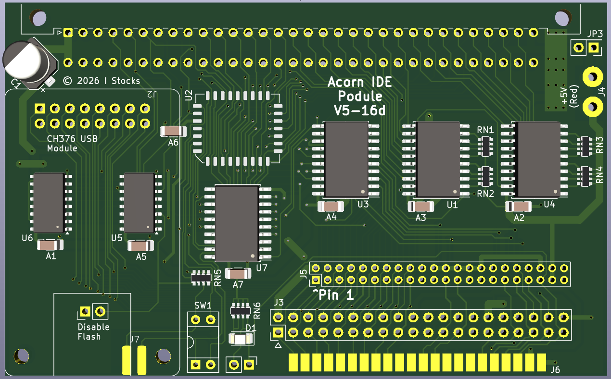

# IDE podule 16 bit

16-bit IDE podule for Acorn machines. It also includes a header for a CH376 USB module compatible with USBFS.

Compatibe with the interface number 0 version of ZIDEFS - https://www.zeridajh.org/software/zidefs/index.html

Flash can be programmed in-situ, so the chip can be soldered on-board without a socket. Programming software will be added later. 

More details on USBFS and a stand-alone USBFS podule here - https://codeberg.org/IanS/ch376_podule

The flash chip (SST39SF010) can be used in its entirety as a single 128K block with both switches turned on. It make more sense to treat it as four 32K chunks to allow the alternative version of the ZIDEFS software to be used. Using the different versions (ZIDEFS/IDEFS/SIDEFS) allows multiple podules to be installed in a single machine. Note that the ZIDEFS partitioning, deviceid and formatting tools only work with the ZIDEFS version. 

As well as fitting any Acorn machine with a normal podule backplane, it can also be fitted in an A3xx machine without a backplane. To fit it without a backplane, remove the jumper on JP3 and connect the spare red wire (+5V) from the power supply to the podule. Then plug the podule directly into the motherboard. Do not try this with any other machines as the connector is the wrong way around. (In theory you can also do this with an original A440, *not* an A4xx/1, but as the A440 was sold with a backplane, it's unlikely this will be needed.)

PCB

